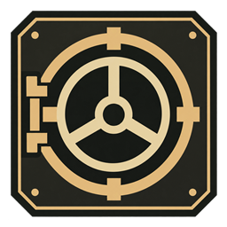

# Bedrock Station 1.0.0

Bedrock Station is a single-player bunker survival game. Excavate tunnels, build rooms, and assign your crew to keep food, water, fuel, and power flowing. Mine ore to research upgrades and craft weapons before raiders reach the vault door.

## Run locally

Use Node.js 22 or later. From the project directory, run the following.

```sh
npm ci
npm run dev
```

Open the local address printed by Vite.

```sh
npm test
npm run build
npm run preview
```

The test command runs the simulation suite. The build writes the deployable game to `dist/`, and preview serves that build locally.

## Start a campaign

Choose **New game**, then leave the seed blank for a random map or enter a seed to reproduce the terrain and deposit layout. Seed **42** starts on flat ground with an exterior stairwell. Seed **43** starts at the foot of a mountain, with the vault door inside a tunnel.

The game starts paused with four residents, staffed hydroponics, and a staffed generator. **Excavate** rock next to an open tile. The starter aquifer is on the left and the oil seam is on the right. Use **Build** and click the left tile of a room's two-tile footprint. Put a pump over exposed water and an extractor over exposed oil, then staff them from **Crew**. Run the clock at **1×**, **2×**, or **4×** when ready. Supply shortages reduce crew condition and production.

Drag the map or use WASD or the arrow keys to pan. Use the mouse wheel or map buttons to zoom. **Surface**, **Gate**, and **Cavern** jump to their respective areas. Select a room on the map to see its staffing, level, and any mineral reserves.

## Mining, research, and equipment

| System | How it works |
| --- | --- |
| Mining | Excavate iron and copper seams, then build and staff an **Ore mine** over exposed ore. On new maps, the first iron and copper seams are one floor below the starter water and oil seams. Mines use power, and each deposit has a finite reserve displayed when you select its mine. |
| Research | Staff a **Research lab**, then select a project in **Research**. Projects consume materials and ore up front and progress while the lab has workers and power. **Reinforced construction** unlocks Level 2 rooms. **Sidearm fabrication** unlocks pistols and is required before **Rifle fabrication**. |
| Building upgrades | After completing Reinforced construction, select a room and choose **Upgrade to level 2**. Upgrades keep the room and its crew in place. Depending on the room, they improve production, mining, research, fabrication, beds, storage, or guard strength. |
| Weapons | Staff a **Workshop** and craft an unlocked pistol or rifle under **Research**. Use the weapon selector beside each resident in **Crew** to equip a weapon or return it to inventory. Pistols add 1 defense and rifles add 2 for residents assigned to the gate or a guard post. |

## Defend and expand

- Raiders approach through a side tunnel on the outside of the vault door. Staff the **Bunker gate** or a **Guard post** to repel them. A breach can cost food and lower crew condition. Between raids, you can repair up to 40 percentage points of gate integrity for 8 materials.
- Assign **Woodcutting** and **Surface scavenging** for materials and food. Trees regrow and animals return. Surface workers shelter inside during raids and resume their assignments afterward. **Cave scavenging** supplies a smaller amount of food underground.
- Add **Quarters** to raise the resident limit and **Storage** to increase stockpile capacity. Recruits can arrive while supplies are stable. The **Log** records shortages, recoveries, raids, research, fabrication, and other events.

## Saves and offline progress

The game autosaves one campaign to IndexedDB in the current browser profile and site address. **New game** asks before replacing that campaign. Pre-1.0 saves gain ore and research when they load, while keeping existing rooms, crew, and stockpiles.

When you reopen the campaign or return to a hidden tab, the game simulates up to 15 minutes at normal speed, including raids, mining, research, and fabrication. The return report summarizes changes, and the live clock stays paused. Local and deployed copies have separate browser saves.

## Deploy to Vercel

Import the project into Vercel and select this project directory as the root. The included `vercel.json` specifies Vite, the `npm run build` command, and the `dist` output directory. The static game needs no server-side database or environment variables. The vault-door logo and browser favicon are included in the build.

Built with React, Phaser, and Vite.
